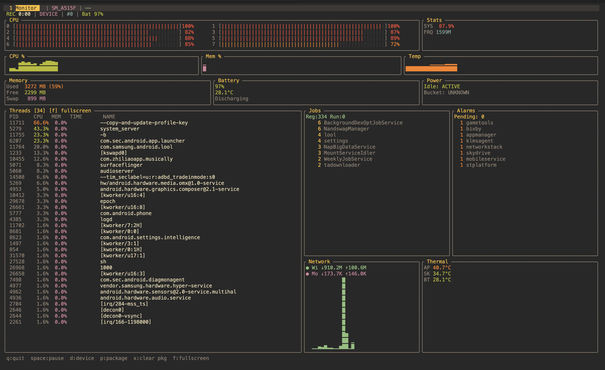

# Android Performance Monitor

A fast, btop-style terminal UI for monitoring Android device and per-app performance in real time — over ADB, no root required.



## Features

- **Per-core CPU** — live usage bars and frequencies for every core
- **App CPU & threads** — top threads table with PID, CPU%, memory, core affinity
- **Memory** — used / free breakdown
- **Battery & Power** — level, charging state, doze / idle state
- **Thermal** — AP, SKIN, and battery temperatures with history
- **Network** — per-app and total Wi-Fi / mobile RX / TX with sparklines
- **Jobs & Alarms** — scheduled jobs and pending alarms for the selected app
- **Device mode** — monitor the whole device, or switch to a specific package
- **Flicker-free rendering** via `ratatui` with async ADB collectors

## Requirements

- [Rust](https://rustup.rs/) 1.75+ (edition 2021)
- [ADB](https://developer.android.com/tools/adb) in your `PATH`
- An Android device with **USB debugging enabled** (wired or over Wi-Fi)

## Install

```bash
git clone https://github.com/aabolfazl/android-perf.git
cd android-perf
cargo build --release
```

The binary will be at `target/release/android-perf`.

## Usage

```bash
# Pick device and package interactively
./target/release/android-perf

# Or pass everything via flags
./target/release/android-perf \
  --device <serial> \
  --package com.example.app \
  --interval 1
```

### CLI options

| Flag | Description | Default |
|------|-------------|---------|
| `-d`, `--device <SERIAL>` | ADB device serial | first device |
| `-p`, `--package <NAME>`  | Package to track | device-wide |
| `-i`, `--interval <SECS>` | Sample interval (seconds) | `1` |
| `-o`, `--output <PATH>`   | CSV output path | none |

### Keybindings

| Key | Action |
|-----|--------|
| `q` / `Esc` | Quit |
| `Space` | Pause / resume sampling |
| `d` | Open device picker |
| `p` | Open package picker (type to filter) |
| `x` | Clear package selection (device-wide mode) |
| `f` | Toggle fullscreen on the threads panel |
| `↑` / `↓` | Navigate lists |
| `Enter` | Select |

## How it works

A single persistent `adb shell` session streams metrics from `/proc`, `dumpsys`, and `top`. Each panel has its own async collector that pushes updates over an `mpsc` channel to the UI thread, which redraws at ~60fps using double-buffered `ratatui`.

## License

MIT — see [LICENSE](LICENSE).
