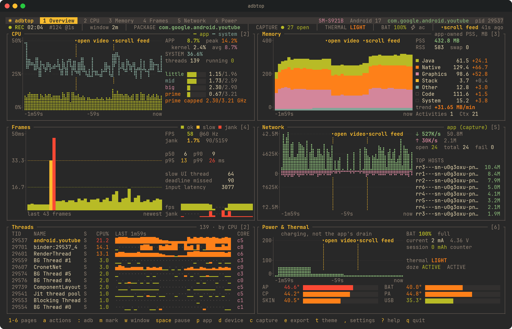
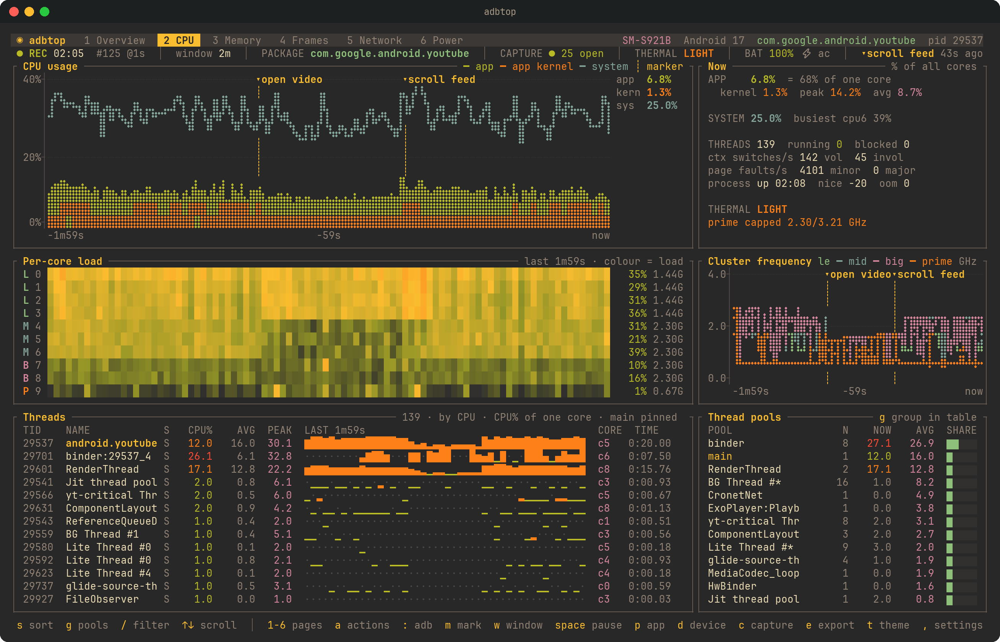
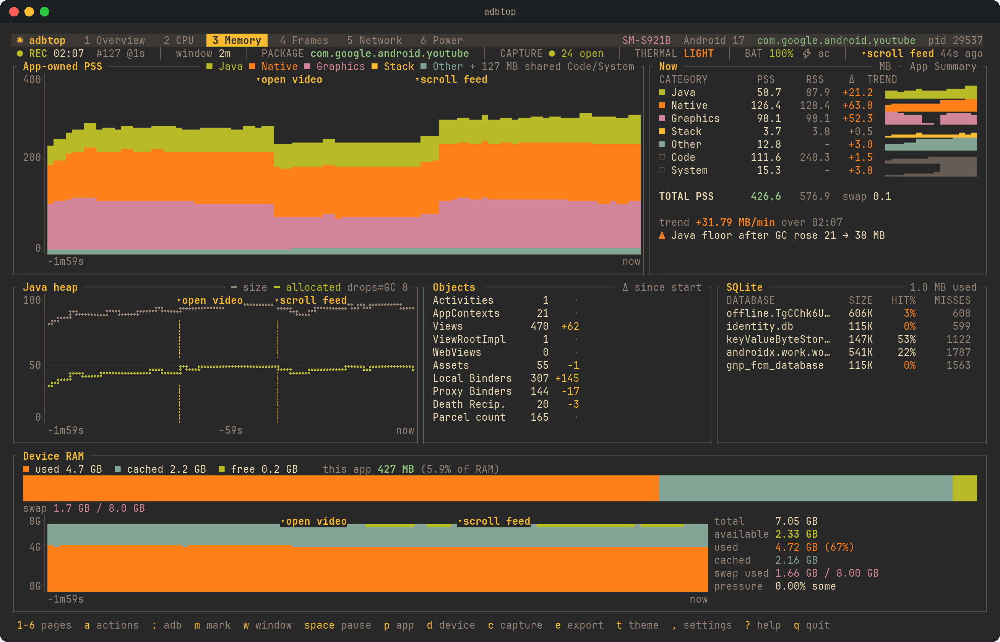
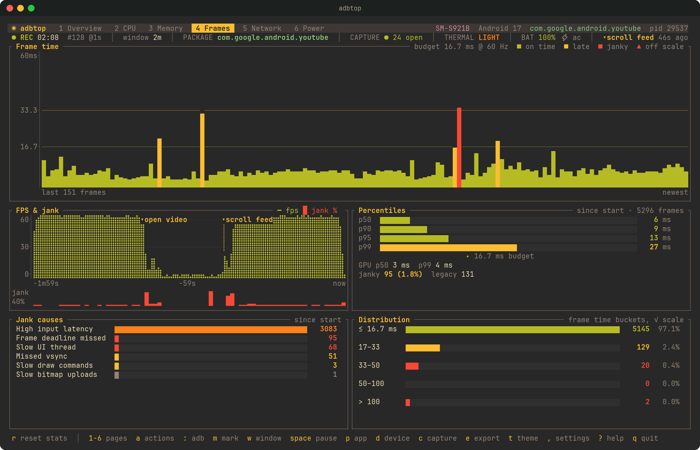
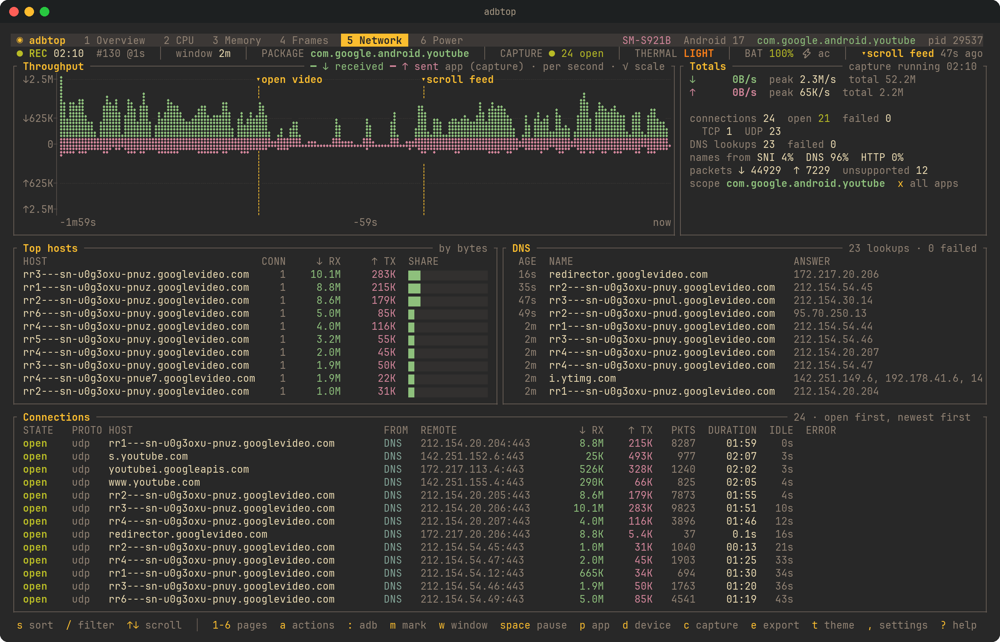

# adbtop

**Live performance for Android apps, in your terminal and your CI.**

CPU, memory, frames, network and power for one app or the whole phone, over adb. No root, nothing to add to your app, no Android Studio.



- **CPU**: app vs system, kernel time, a per-core heatmap grouped by cluster, clock speeds and throttling caps, every thread with its state and history, thread pools
- **Memory**: PSS by category over time, Java heap and GC, Activities, Views and AppContexts with their change since start (leak hints), SQLite
- **Frames**: every frame against the vsync budget, FPS, jank %, percentiles and what caused the jank
- **Network**: traffic per app, every connection with its host name (TLS SNI, DNS or HTTP), DNS lookups and why connections failed, through a small [agent app](android-agent/README.md) that works like a local VPN
- **Power**: battery drain in mA and W, mAh used, every thermal sensor, throttling, Doze, standby bucket, jobs and alarms
- **Headless**: `record` and `snapshot` print JSON or CSV, markers measure a single action, `--assert` fails a CI job on a regression. Built to be driven by scripts and AI agents.

When the phone can't provide something, the panel says **not supported on this device** and why, instead of showing zeros.

## Install

You need [adb](https://developer.android.com/tools/adb) on your `PATH` and a phone with **USB debugging** on. Android 6 or newer; frame stats, thermal status and memory pressure need newer versions.

### macOS

```bash
brew install aabolfazl/tap/adbtop
```

### Linux

```bash
curl -LsSf https://github.com/aabolfazl/adbtop/releases/latest/download/adbtop-installer.sh | sh
```

The script also works on macOS. It puts `adbtop` in `~/.local/bin`. Prebuilt binaries for both are on the [releases page](https://github.com/aabolfazl/adbtop/releases).

#### Arch Linux

Install from the [official repositories](https://archlinux.org/packages/extra/x86_64/adbtop/):

```bash
pacman -S adbtop
```

### With Cargo

```bash
cargo install adbtop
```

### From source

```bash
git clone https://github.com/aabolfazl/adbtop.git
cd adbtop
cargo build --release      # target/release/adbtop, needs Rust 1.78+
```

A source build doesn't include the capture agent. Build it with Gradle ([agent README](android-agent/README.md)) and install it with `adbtop agent install --apk <path>`.

## Use

```bash
adbtop                          # pick a device and an app inside the UI
adbtop -p com.example.app       # start on one app
adbtop -p com.example.app --capture   # with per-app network capture
```

| CPU | Memory |
|---|---|
|  |  |
| **Frames** | **Network** |
|  |  |

### Keys

| Key | Action |
|---|---|
| `1`–`6`, `Tab` | Overview, CPU, Memory, Frames, Network, Power |
| `p` / `x` / `d` | Pick an app / watch the whole device / pick a device |
| `m` / `M` | Drop a marker on every chart / with a label |
| `w` | Chart window: 1, 2, 5, 15, 30 minutes |
| `c` | Start or stop the network capture |
| `a` | Actions: launch, cold start (measured and marked), force stop, reset frame stats, Doze, standby bucket, fake unplug, install the capture agent |
| `:` | Run any adb command on this device, with the output in a scrollable window |
| `s`, `g`, `/`, `↑↓` | Sort, group thread pools, filter, scroll |
| `e` | Save a JSON report of this session |
| `t`, `,`, `?` | Next theme, settings, help |
| `Space`, `q` | Pause, quit |

Anything adbtop changes on the phone (forced Doze, fake unplug, standby bucket) shows as a ⚠ badge and is undone when you quit or switch devices. The network capture stops when adbtop exits, and the agent stops itself if adbtop dies without cleaning up.

### Network capture

Per-app connections need the agent app on the phone. adbtop installs the version that matches it:

```bash
adbtop agent install
```

The first capture asks for VPN permission on the phone once. Traffic is not sent anywhere: the agent forwards it to where it was going and measures it on the way. HTTPS stays encrypted; you see where it goes, not what is in it. Details in the [agent README](android-agent/README.md).

## Scripts, CI and AI agents

Every command prints JSON on stdout and progress on stderr, and never asks for input.

```bash
adbtop record -p com.example.app --duration 60s > report.json
adbtop record -p com.example.app -m cpu,memory --samples - -o report.json   # one JSON line per second
adbtop record -p com.example.app --duration 5m --samples samples.csv -o report.json
adbtop snapshot -p com.example.app
adbtop devices
adbtop packages
```

Measure one action, for example from an agent that drives the phone:

```bash
adbtop record -p com.example.app -o login.json &
adb shell input tap 540 1680
adbtop mark "tapped login"
sleep 15
adbtop stop
```

The report's `after_markers` section shows what followed each marker: peak CPU, PSS change, bytes downloaded, janky frames and battery drain.

Fail a CI job on a regression. Each `--assert` is `PATH OP NUMBER` over the report:

```bash
adbtop record -p com.example.app --duration 2m \
  --assert 'frames.janky_pct < 5' \
  --assert 'memory.pss_mb.growth_per_min < 0.5' \
  --assert 'network.failed == 0' \
  -o ci.json
```

### Claude Code and Codex

One command teaches your coding agent to use adbtop: which commands to run, how to measure a single action, and how to read the report.

```bash
adbtop skill install            # Claude Code and Codex, whichever you have
adbtop skill install --claude   # only one of them
```

Then ask in plain words, for example "check whether com.example.app leaks memory when I open and close the settings screen". The skill is [`skills/adbtop/SKILL.md`](skills/adbtop/SKILL.md); `adbtop skill uninstall` removes it. In Codex you can also install it from GitHub with `$skill-installer https://github.com/aabolfazl/adbtop/tree/master/skills/adbtop`.

### Report

`"schema": "adbtop/report@1"`

| Section | Contents |
|---|---|
| `device`, `app`, `session` | Model, Android version, CPU clusters; package, pid, restarts; start, duration, samples |
| `unsupported` | What this phone can't provide, and why |
| `cpu` | App, kernel and system % (avg, min, max, p95, last), per core, cluster clocks and caps, top threads |
| `memory` | PSS with `growth_per_min`, PSS by category, Java heap and GC estimate, object counts at start and end, SQLite, device RAM and pressure |
| `frames` | Frames, janky %, p50–p99, GPU percentiles, refresh rate, FPS, jank causes |
| `network` | Bytes, rates, connections, failures, top hosts, DNS failures |
| `power` | Battery, `drain_ma`, `used_mah`, thermal status and peak per sensor, Doze, jobs |
| `markers`, `after_markers` | Markers and what followed each one |
| `warnings` | Plain sentences with numbers: PSS growing, AppContexts growing while Activities stay flat, failing hosts, throttling, phone plugged in |
| `assertions` | Each check, its value and whether it passed |

App and system CPU are shares of all cores (100 = every core busy); thread CPU is % of one core.

| Exit code | Meaning |
|---|---|
| 0 | OK |
| 1 | Error |
| 2 | Bad arguments |
| 3 | An `--assert` failed |
| 4 | Device or app not found, device not authorized, or several devices and no `-d` |
| 5 | Capture agent missing or not allowed |

Errors are printed as `{"error": {"code": "...", "message": "..."}}`.

## Settings and themes

`,` opens the settings; they are saved in `~/.config/adbtop/config.toml`. Command-line flags override them. You can set the theme, braille or block charts, the start page, CPU % as a share of all cores or of one core, °C or °F, the chart window, sampling rates, history length, and turn off collectors you don't need to reduce load on the phone.

14 themes are built in (`adbtop themes`): Gruvbox Dark, Catppuccin Mocha, Tokyo Night, Nord, Dracula, One Dark, Solarized Dark, Kanagawa, Everforest Dark, Monokai, GitHub Dark, Ayu Dark, Night Owl and Catppuccin Latte. Add your own on top of one:

```toml
[themes.mine]
base = "nord"
bg = "#101418"
accent = "#ffcc66"
```

## Good to know

- A phone on USB charges, so the battery current is not your app's drain. Measure power over Wi-Fi adb (`adb tcpip 5555`).
- `dumpsys meminfo` takes about 0.4 s on the phone, so app memory is sampled every 2 s.
- Android keeps the last ~120 frames, so at 120 Hz a few can be missed between samples. Jank % and percentiles come from Android's own counters and are exact.
- Linux cuts thread names to 15 characters.

## How it works

All the fast `/proc` reads (CPU, threads, memory, network, clocks) are one `grep` per interval over a persistent `adb shell`. `dumpsys meminfo`, `dumpsys gfxinfo` and the slower services each have their own shell, so a slow command never delays the others. At startup a probe reads the Android version, the CPU clusters and which services exist. Everything feeds one session that keeps the history; the TUI, the JSON report and the sample stream all read from it.

The [agent app](android-agent/README.md) runs a local VPN on the phone and streams protobuf snapshots ([`proto/agent.proto`](proto/agent.proto)) over `adb forward`.

The long version, with diagrams and the bugs along the way: [How adbtop watches an Android app without touching it](https://latentbits.dev/writing/how-adbtop-works/).

## License

MIT, see [LICENSE](LICENSE).
